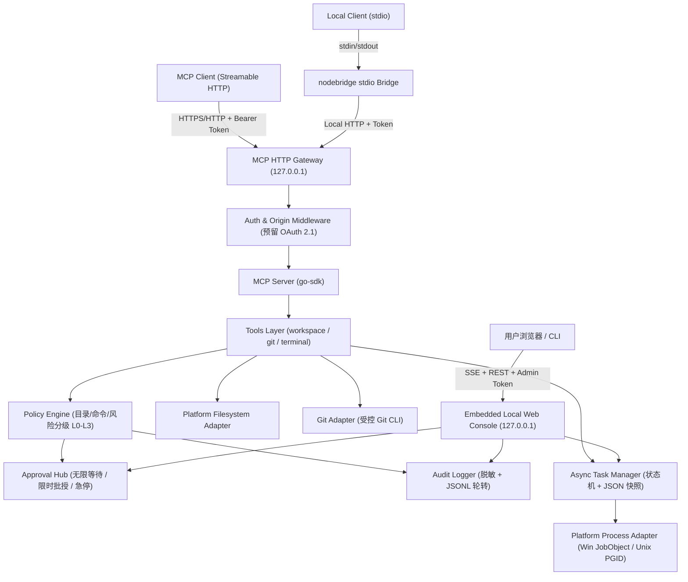

# NodeBridge 阶段一实施计划（Local MCP Server）

> 参考方案文档：[personal-computer-agent-gateway.md](../personal-computer-agent-gateway.md)

## 1. 已对齐的核心决策

| 决策维度 | 最终方案 | 说明 |
| :--- | :--- | :--- |
| **里程碑范围** | 阶段一完整闭环 + 预留阶段二扩展点 | 先打通本地安全 MCP 执行闭环，预留认证中间件与 Relay/隧道抽象，不阻塞于外部云端平台限制 |
| **语言与 SDK** | Go 1.24 + `github.com/modelcontextprotocol/go-sdk` | 单二进制跨平台分发，原生并发与底层进程树控制能力强 |
| **MCP 传输层** | 常驻 Streamable HTTP（主）+ 轻量 `stdio` 桥接子命令 | 主服务默认监听 `127.0.0.1` + Origin 校验 + Bearer Token；`nodebridge stdio` 代理本地 Daemon 兼容 stdio 客户端 |
| **审批与急停交互** | Go `embed.FS` 内嵌本地 Web 控制台（SSE）+ CLI 子命令 | 零前端构建依赖、零 CGo；浏览器端支持 Diff 预览、单次/限时批授、急停、任务与审计监控 |
| **审批等待策略** | 无限等待用户批准/拒绝（默认 `approval_timeout: 0`） | 直到用户操作、客户端主动断开 HTTP Context 或触发急停；附 SSE 心跳保活，配置中预留可选超时供阶段二启用 |
| **终端安全策略** | 参数数组优先 + 分层风险策略 | 可配置白名单低风险自动/会话批授；未知程序与显式 `use_shell: true` 自动升级 L2/L3 强制人工审批；危险模式默认拦截 |
| **配置与持久化** | YAML 配置 + 本地 JSON/JSONL 持久化 | 内存索引 + 任务 JSON 快照 + 脱敏轮转 JSONL 审计日志；零 CGo，抽象 `Store` 接口供阶段三平滑切 SQLite |
| **文件变更协议** | `workspace.patch`（Search/Replace + SHA256 乐观锁）+ `git.apply_patch`（Unified Diff） | 兼顾大模型高成功率与防并发覆盖；审批 UI 统一渲染标准 Unified Diff 供人工核对 |
| **工程化与跨平台** | 初始化 Git、主程序 `nodebridge`、Windows 全量测试 + `darwin`/`linux` 交叉编译 & 三平台 CI | Windows 首发适配（Job Objects、NTFS/UNC/ADS 防护），同步完成 Unix Build Tags 与 GitHub Actions CI |

---

## 2. 系统架构与代码布局

### 2.1 阶段一运行时架构



### 2.2 建议目录结构

```text
NodeBridge/
├── .github/
│   └── workflows/
│       └── ci.yml                       # Windows / macOS / Linux 三平台构建与测试 CI
├── .gitignore
├── go.mod                               # module nodebridge (Go 1.24)
├── go.sum
├── docs/
│   └── stage1-implementation-plan.md    # 阶段一实施计划文档
├── configs/
│   └── nodebridge.example.yaml          # 默认配置模板（工作区、策略、安全基线）
├── cmd/
│   └── nodebridge/
│       └── main.go                      # CLI 入口：daemon / stdio / init / approve / reject / stop-all / tasks / status
├── internal/
│   ├── config/                          # YAML 加载、Schema 校验、默认值与 Token 自动生成
│   ├── core/
│   │   ├── store/                       # Store 接口 + 本地 JSON/JSONL 持久化实现
│   │   ├── audit/                       # 审计模型、敏感字段脱敏器、JSONL 轮转写入器
│   │   ├── policy/                      # 风险分级 L0-L3、路径规则、命令规则、敏感文件检测
│   │   ├── approval/                    # 审批队列、无限等待 Broker、限时工作区批授、一键急停状态
│   │   ├── task/                        # 异步任务状态机、并发上限、输出 RingBuffer、清理器
│   │   └── session/                     # 会话上下文、调用来源元数据、AuthProvider 接口（预留 OAuth）
│   ├── platform/
│   │   ├── capability/                  # 启动能力探测（Git、PowerShell/sh、OS/Arch）
│   │   ├── filesystem/                  # 跨平台路径规范化、防穿越/防符号链接逃逸、文件锁、Search/Replace + Unified Diff 生成
│   │   ├── process/                     # 进程抽象 + process_windows.go (Job Objects) / process_unix.go (PGID)
│   │   └── git/                         # 受控 Git CLI 封装（status / diff / apply --check & apply）
│   ├── mcpserver/
│   │   ├── server.go                    # go-sdk Server 初始化、StreamableHTTPHandler + Origin/Bearer 校验
│   │   ├── stdio_bridge.go              # 轻量 stdio -> 本地 Streamable HTTP 转发桥
│   │   └── tools/                       # 10 个 P0 MCP 工具注册与参数校验
│   ├── admin/
│   │   ├── server.go                    # 本地管理 REST API + SSE 事件流（独立端口 + Admin Token）
│   │   └── web/                         # embed.FS 内嵌原生 HTML/CSS/JS 控制台（零外部前端构建）
│   └── transport/
│       └── relay/                       # 阶段二预留：Tunnel / Relay 抽象接口与配置桩
└── test/
    └── e2e/                             # 端到端 MCP 客户端测试（完整审批、补丁、Git、终端、安全拒绝闭环）
```

---

## 3. 核心模块设计规范

### 3.1 四层安全边界与目录隔离

1. **工作区路径安全校验（`internal/platform/filesystem`）**：
   - 每个工作区配置 `id`、`root`、`read_only`、`deny_globs`。
   - 所有请求路径必须先做语法清洗，再通过 `filepath.EvalSymlinks` 解析真实路径（新建文件则解析最近存在的父目录真实路径），并验证解析后的真实路径严格位于授权 `root` 真实路径之内。
   - **Windows 专项防护**：显式拦截 UNC 网络路径（`\\server\share`、`//server/share`）、设备路径（`\\.\`、`\\?\`）、Alternate Data Streams（路径段中包含冒号 `file.txt:stream`）、保留设备名（`CON`, `NUL`, `AUX`, `PRN`, `COM1-9`, `LPT1-9`），以及盘符大小写一致性归一化。
   - **默认敏感文件拒绝列表**（读取/写入/搜索均默认拒绝，不可绕过）：`.env`, `.env.*`, `*.pem`, `*.key`, `id_rsa*`, `id_ed25519*`, `.ssh/**`, `.aws/**`, `.npmrc`, `.pypirc`, `credentials.json`, `*secret*`（可在配置中审计覆盖）。

2. **命令策略与风险分级（`internal/core/policy`）**：
   - **L0 只读**：`workspace.list`, `workspace.read`, `workspace.search`, `git.status`, `git.diff`, `terminal.poll` -> 授权工作区内自动放行。
   - **L1 普通写入/开发测试**：`workspace.patch`（修改/新建源码）、`git.apply_patch`、以及配置白名单内低风险开发命令（如 `go test`、`go vet`、`npm test`、`pytest`、`git log`）-> 默认审批，支持用户在审批界面选择**“对该工作区限时批量授权（如 15/30/60 分钟）”**。
   - **L2 高风险**：不在白名单的未知可执行文件、显式 `use_shell: true`、依赖安装命令（如 `npm install`、`pip install`、`go get`）、删除类命令 -> **强制每次明确人工审批**（不享受 L1 批量授权）。
   - **L3 关键/禁止操作**：`git push`、`git reset --hard`、提权命令（`sudo`, `runas`, `gsudo`）、管道下载执行（`curl | sh`, `iwr | iex`）、磁盘/注册表/防火墙/系统配置命令 -> 默认**硬拒绝**或需每次单独确认。
   - **防提示词注入**：所有工具返回内容采用统一结构，附带明确来源字段（`source: "local_workspace_file" | "terminal_output" | "git_output"`）与截断标记；权限评估完全在本地 Go 代码中执行，不信任任何来自模型或文件内容的指令。

### 3.2 人工审批与一键急停（`internal/core/approval` + `internal/admin`）

- **无限等待模型**：
  - 触发审批时创建 `ApprovalRequest`（含 `id`, `tool`, `risk_level`, `workspace_id`, `summary`, `diff_preview`, `command_preview`, `reason`, `created_at`），通过 SSE 推送至本地 Web 控制台并写入终端日志。
  - 调用协程阻塞等待 `decisionCh` 或 `ctx.Done()` 或 `killSwitchCh`；`approval_timeout` 默认 `0`（无限等待），如果客户端主动取消连接或用户点击急停，审批自动置为 `CANCELLED` 并通知前端移除弹窗。
- **审批动作**：
  - `ApproveOnce`：仅放行当前这次调用；
  - `ApproveWorkspaceTTL(duration)`：仅适用于 L1 操作，在限定时间窗口内自动放行同一工作区的同级别操作（可随时在控制台一键撤销全部临时授权）；
  - `Reject(reason)`：立即拒绝并把明确原因返回给 MCP 客户端。
- **一键急停（Kill Switch）**：
  - Web 控制台顶部常驻红色急停区与 `nodebridge stop-all` CLI 命令：
    1. **暂停模式（Pause）**：立即拒绝所有新的 L1/L2/L3 工具调用与待审批队列；
    2. **紧急终止（Kill All）**：在暂停的同时，立刻向 `TaskManager` 下发强杀指令，终止所有运行中任务及其完整子进程树，并撤销全部临时批量授权。

### 3.3 10 个 P0 MCP 工具接口契约（`internal/mcpserver/tools`）

| 工具名 | 风险级别 | 核心输入参数 | 核心输出与保护机制 |
| :--- | :---: | :--- | :--- |
| `workspace.list` | L0 | `workspace_id`, `path`, `max_depth`, `limit` | 返回相对路径、类型、大小、修改时间；默认跳过 `.git`、`node_modules` 与敏感文件 |
| `workspace.read` | L0 | `workspace_id`, `path`, `start_line`, `end_line` | 返回带行号文本、总行数、是否截断及 **`sha256`**（用于写入乐观锁）；拒绝二进制和超大文件 |
| `workspace.search` | L0 | `workspace_id`, `query`, `is_regex`, `glob`, `max_results` | 纯 Go 高效遍历搜索，跳过敏感/二进制文件，严格限制结果条数与单行长度 |
| `workspace.patch` | L1 | `workspace_id`, `path`, `expected_sha256`, `create_if_missing`, `edits: [{old_text, new_text}]` | 路径互斥锁 + SHA256 校验 + 原子替换；审批前实时生成 Unified Diff 供审阅；返回新 `sha256` 与 Diff 摘要 |
| `git.status` | L0 | `workspace_id` | 执行 `git status --porcelain=v2 --branch`，返回分支、暂存/未暂存/未跟踪清单 |
| `git.diff` | L0 | `workspace_id`, `staged`, `paths`, `max_bytes` | 执行受限 `git diff`，强制输出上限截断 |
| `git.apply_patch` | L1 | `workspace_id`, `patch` | 先解析补丁涉及的所有目标路径并逐一通过目录/敏感文件校验，再用 `git apply --check` 预检，审批通过后执行 `git apply` |
| `terminal.start` | L1/L2/L3 | `workspace_id`, `executable`, `args`, `cwd`, `env_allow`, `timeout_seconds`, `use_shell` | 不接受原始拼接字符串（除非 `use_shell: true` 且过 L2/L3 审批）；返回 `task_id` 与初始状态 |
| `terminal.poll` | L0 | `task_id`, `stdout_offset`, `stderr_offset` | 返回当前状态、退出码、耗时、增量 stdout/stderr 切片及是否截断 |
| `terminal.cancel` | L0 | `task_id` | 终止整个进程树（Windows Job Object `TerminateJobObject` / Unix `-pgid` `SIGTERM -> SIGKILL`），更新状态为 `CANCELLED` |

### 3.4 异步任务状态机与跨平台进程控制（`internal/core/task` & `internal/platform/process`）

- 状态流转：`CREATED -> QUEUED -> RUNNING -> (SUCCEEDED | FAILED | CANCELLED | TIMED_OUT)`。
- 并发与资源限制：默认最大并发任务数 `4`、默认单任务超时 `300s`、单任务日志输出内存上限 `1MB`。
- **Windows 实现（`process_windows.go`）**：创建进程时挂载到独立 Windows Job Object（启用 `JOB_OBJECT_LIMIT_KILL_ON_JOB_CLOSE`），取消或超时时终止 Job Object，彻底清理子进程树。
- **macOS / Linux 实现（`process_unix.go`）**：设置 `SysProcAttr{Setpgid: true}`，取消时先向 `-pgid` 发送 `SIGTERM`，宽限后发 `SIGKILL`。
- **持久化**：任务元数据通过 `Store` 接口持久化到本地 `tasks.json`（Daemon 重启后未终态任务自动收敛为 `FAILED`）。

### 3.5 审计日志与脱敏（`internal/core/audit`）

- 每一次 MCP 工具调用均写入结构化 JSONL 记录：`timestamp`, `event_id`, `session_id`, `client_info`, `tool`, `workspace_id`, `risk_level`, `args_summary`, `decision`, `approver`, `duration_ms`, `status`, `error`。
- 内置脱敏管道：自动擦除 `Authorization`、Bearer Token、API Key、私钥块及敏感凭据字段。
- 支持按单文件大小自动轮转（默认 10MB）和最大保留文件数限制（默认 10 份）。

---

## 4. 分阶段实施路线（阶段一内部里程碑）

1. **阶段 1.1**：工程初始化与配置/存储/审计基线
2. **阶段 1.2**：安全路径、文件系统与 Git 适配器
3. **阶段 1.3**：跨平台进程适配器与异步任务管理器
4. **阶段 1.4**：策略引擎、人工审批中心与内嵌 Web 控制台
5. **阶段 1.5**：MCP Server、Streamable HTTP 与 `stdio` 桥接
6. **阶段 1.6**：端到端验收、交叉编译与三平台 CI 闭环

---

## 5. 验证与验收计划

1. **只读探索闭环**：`workspace.list`、`workspace.read`（含 `sha256`）、`workspace.search`、`git.status`、`git.diff` 授权目录内自动放行。
2. **受控写入与审批闭环**：`workspace.patch` 与 `git.apply_patch` 挂起无限等待，Web 控制台展示 Unified Diff 预览，批准更新、拒绝不变。
3. **并发冲突防护**：过期 `expected_sha256` 触发乐观锁拒绝。
4. **异步终端与进程树取消**：`terminal.start`/`poll`/`cancel` 与一键急停完整验证。
5. **安全对抗测试**：拦截 `../`、符号链接逃逸、UNC/ADS/保留名、`.env`/`id_rsa`、高危命令、无 Token 及非法 Origin。
6. **审计与急停**：脱敏 JSONL 落盘且急停拦截后续新操作。
7. **跨平台构建**：Windows 本机 `go test ./...` 全通过，`linux/amd64` 与 `darwin/arm64` 交叉编译零错误。
