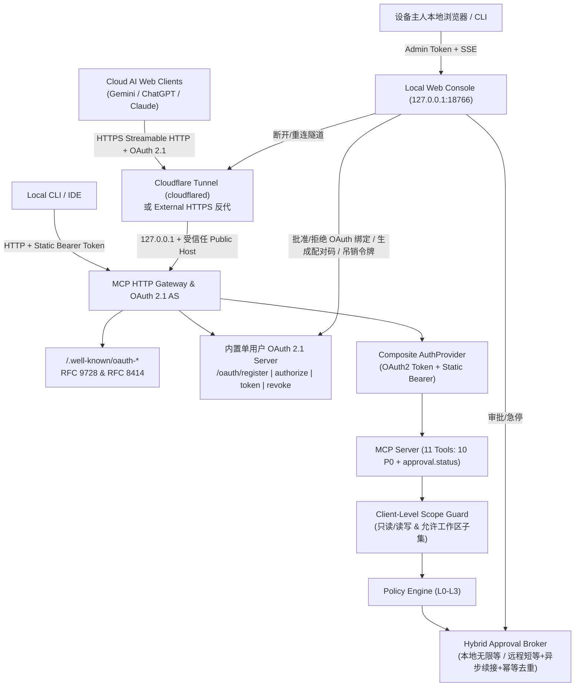
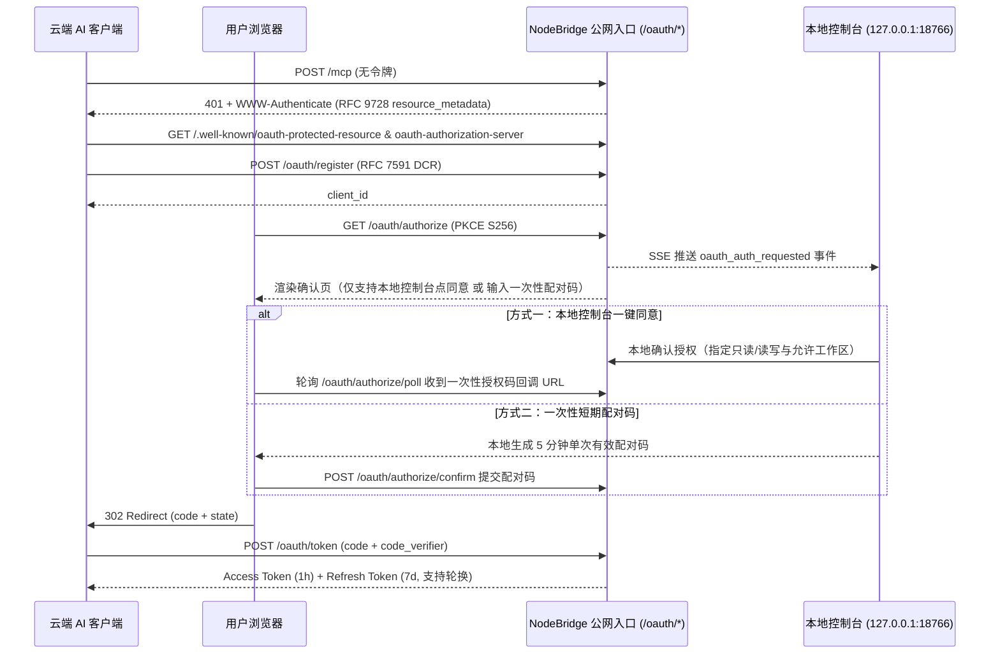

# NodeBridge 阶段二实施计划（远程安全接入与云端网页端 MCP 闭环）

> 参考总体方案：[personal-computer-agent-gateway.md](../personal-computer-agent-gateway.md)  
> 阶段一基线计划：[stage1-implementation-plan.md](./stage1-implementation-plan.md)

## 1. 已对齐的核心决策

| 决策维度 | 最终方案 | 说明 |
| :--- | :--- | :--- |
| **目标客户端范围** | 标准远程 MCP 规范（Streamable HTTP + OAuth 2.1） | 兼容 **Gemini Web / ChatGPT Web / Claude Web** 等主流云端网页端，同时向下兼容静态 Bearer Token 客户端（CLI / IDE） |
| **公网 HTTPS 通道** | Cloudflare Tunnel 优先 + `external` 外部反代模式 | 托管编排本机 `cloudflared`（支持 Named 固定域名与 Quick 临时域名）；同时支持 `external` 模式接入用户自有 Tailscale Funnel / Caddy / FRP；自建公网 Relay 留待阶段三多设备路由 |
| **OAuth 2.1 授权架构** | NodeBridge 内置零依赖单用户 OAuth 2.1 授权服务器 | 完整实现 RFC 9728（Protected Resource Metadata）、RFC 8414（AS Metadata）、RFC 7591（DCR）与 PKCE S256；签发短期 Access Token + 可轮换/可吊销 Refresh Token（含重放检测） |
| **公网授权安全边界** | 零长期凭据暴露公网 | 公网 `/oauth/authorize` 绝不提交 `admin_token`；支持“本地审批控制台实时点击批准（公网页等待并自动 302 回调）”与“一次性短期配对码（5 分钟有效、单次消费、IP 限流）”双选 |
| **远程超时与幂等续接** | 混合短等待 + 异步续接 + 请求指纹幂等 | 本地连接保留默认无限等待；远程请求先同步等待可配置短窗口（默认 45s，附 MCP Progress 保活），超时不销毁审批单并返回结构化 `APPROVAL_PENDING`（含 `approval_id`）；批准后后台续接执行，新增 `approval.status` 只读工具查询，并对短时间重发请求做指纹幂等防重复执行 |
| **急停与细粒度管控** | 分层止损 + 客户端级独立授权 | 持久化本机 `device_id` 与已绑定 OAuth 客户端清单；支持按客户端限定只读/读写模式与工作区子集、单点吊销；`Kill All` 默认强杀任务 + 暂停远程执行，同时提供独立“断开隧道”与“吊销全部远程令牌”能力（并支持配置 `Kill All` 自动断隧道） |
| **交付与验证配套** | 控制台升级 + CLI 诊断 + 远程模拟 E2E + 实操指南 | 升级内嵌 Web 控制台，新增 `pair` / `tunnel` / `clients` / `doctor` CLI 子命令，构建完整远程模拟 E2E 测试套件并编写云端网页端接入文档 |

---

## 2. 阶段二运行时架构与协议时序

### 2.1 系统架构图

### 2.2 零长期凭据暴露的 OAuth 2.1 绑定流程

---

## 3. 核心模块设计规范

### 3.1 配置与设备身份（`internal/config` & `internal/core/store`）

1. **持久化设备身份（`data_dir/device.json`）**：首次启动自动生成高熵 `device_id`（`dev_<16hex>`）并写入 `0600` 权限文件。
2. **远程通道配置（`relay`）**：
   - `mode`：`disabled` | `cloudflared_quick` | `cloudflared_named` | `external`（向下兼容阶段一 `enabled` 字段）。
   - `public_url`：公网 HTTPS 入口地址（`cloudflared_named` 与 `external` 必填，`cloudflared_quick` 运行时自动提取并通知网关）。
   - `tunnel_token`：Cloudflare Named Tunnel Token（支持 `env:ENV_VAR_NAME` 语法从环境变量读取）。
   - `cloudflared_bin`：可选自定义 `cloudflared` 可执行文件路径。
   - `kill_all_disconnect_tunnel`：是否在触发 `Kill All` 时联动立即断开隧道（默认 `false`）。
3. **OAuth 2.1 配置（`oauth`）**：
   - `enabled`：是否启用内置 OAuth 2.1 服务（当 `relay.mode != disabled` 时默认自动开启）。
   - `access_token_ttl_seconds`：默认 `3600`（1 小时）。
   - `refresh_token_ttl_seconds`：默认 `604800`（7 天）。
   - `pairing_code_ttl_seconds`：默认 `300`（5 分钟）。
   - `allow_dynamic_registration`：默认 `true`。
   - `rate_limit_per_minute`：公网 OAuth 敏感接口按来源 IP 限流阈值，默认 `20`。
4. **混合审批配置（`approval` 扩展）**：
   - `remote_wait_seconds`：远程请求同步等待短窗口，默认 `45` 秒。
   - `pending_ttl_seconds`：远程异步续接审批单最大存活时间，默认 `900` 秒。
   - `idempotency_ttl_seconds`：请求指纹幂等缓存窗口，默认 `300` 秒。

### 3.2 远程通道连接器（`internal/transport/relay`）

扩展 `relay.Connector` 接口契约，支持动态开关、公网 URL 获取与状态事件订阅：
- `Start(ctx, mcpHandler)` / `Stop(ctx)` / `Connect()` / `Disconnect(reason)` / `Status()` / `PublicURL()` / `Subscribe()`。
- **CloudflaredConnector**：
  - 自动定位 `cloudflared`，对 `quick` 模式执行 `cloudflared tunnel --no-autoupdate --url http://<mcp_listen>` 并流式解析 stderr 提取 `https://*.trycloudflare.com`；对 `named` 模式执行 `cloudflared tunnel --no-autoupdate run --token <token>`。
  - 进程异常退出时执行指数退避重连（2s → 4s → 8s → 最大 30s）；收到 `Disconnect` 时立即终止子进程并停止自动重连，直到用户手动 `Connect`。
- **ExternalConnector**：
  - 校验 `public_url` 必须为合法 `https://` URL，支持运行期一键 `Disconnect`（在 MCP 网关层立即拒收远程来源流量）与 `Connect` 恢复。

### 3.3 内置单用户 OAuth 2.1 Server（`internal/core/oauth`）

- **元数据与端点**：
  - `GET /.well-known/oauth-protected-resource` 与 `GET /.well-known/oauth-protected-resource/mcp`（RFC 9728）
  - `GET /.well-known/oauth-authorization-server`（RFC 8414）
  - `POST /oauth/register`（RFC 7591 DCR，严格校验 `redirect_uris` 仅允许 `https://` 或 `http://127.0.0.1` / `http://localhost`）
  - `GET /oauth/authorize`、`GET /oauth/authorize/poll`、`POST /oauth/authorize/confirm`（强制 PKCE `S256`）
  - `POST /oauth/token`（支持 `authorization_code` + `refresh_token` 轮换 + 重放检测自动吊销家族令牌）
  - `POST /oauth/revoke`（RFC 7009）
- **凭据安全**：
  - 所有持久化落盘（`data_dir/oauth_state.json`，`0600` 权限）仅存储 Access/Refresh Token 的 SHA-256 哈希，不保存明文令牌。
  - 配对码为单次消费高熵码，连续错误自动限流，过期自动清理。
  - 客户端绑定记录包含 `client_id`、`client_name`、`read_only`、`allowed_workspaces`、`scopes`、`created_at`、`last_used_at`、`revoked`。

### 3.4 MCP HTTP 网关远程适配（`internal/mcpserver` & `internal/core/session`）

- **DNS Rebinding 与公网 Host 精确白名单**：
  - 由于 `cloudflared`/本地反代转发给 `127.0.0.1` 时保留了公网域名 `Host` 头，网关层显式校验 `Host` 仅允许 `localhost` / `127.0.0.1` / `[::1]` 或当前受信任的 `public_url` Host，拦截非法 Host（403），之后在 `StreamableHTTPOptions` 中交由自定义 Host 防护接管。
- **CORS 与 RFC 9728 响应头**：
  - 支持 `OPTIONS` 预检请求，允许 `Authorization`、`Content-Type`、`Mcp-Session-Id`、`MCP-Protocol-Version`、`Last-Event-ID`，并暴露 `Mcp-Session-Id` 与 `WWW-Authenticate`。
  - 未鉴权请求返回 `401 Unauthorized` 并附带 `WWW-Authenticate: Bearer realm="nodebridge", resource_metadata="<base>/.well-known/oauth-protected-resource"`。
- **复合鉴权与远程流量总闸**：
  - `CompositeAuthProvider` 优先校验 OAuth 2.1 Access Token（返回 `Principal.IsRemote = true` 及客户端级 `ReadOnly` / `AllowedWorkspaces`），其次回退校验本地静态 `mcp_token`。
  - 当 `relay` 处于已手动断开状态时，直接拦截通过远程通道到达的请求（`503 Service Unavailable`）。

### 3.5 混合审批续接、保活与幂等（`internal/core/approval` & `internal/mcpserver/tools`）

- **客户端级权限护栏**：所有工具在执行前统一校验 `Principal.AllowedWorkspaces` 与 `Principal.ReadOnly`，越权请求直接拦截并写入审计日志。
- **混合短等待 + 异步续接**：
  - 本地调用保持原有无限等待语义。
  - 远程调用计算请求指纹 `SHA256(client_id | tool | workspace_id | canonical_args)`：
    1. 若指纹命中 `IdempotencyTTL` 内正在等待的审批单：直接复用同一 `approval_id` 继续等待，不重复弹窗；
    2. 若指纹命中已批准并执行完成的记录：直接返回缓存结果，杜绝断线重试导致的重复写文件或重复启动任务；
    3. 首次触发时进入短等待窗口（默认 45s），期间每 10s 发送 `NotifyProgress` 保活；
    4. 若短窗口超时或 HTTP Context 断开：审批单继续在本地控制台保留至 `PendingTTL`，并挂载后台执行闭包；本次调用返回结构化 `APPROVAL_PENDING`（含 `approval_id` 与操作指引）；
    5. 用户在本地控制台批准后，后台自动执行挂载闭包并缓存结果；云端模型调用新增的只读工具 **`approval.status`**（或重发同指纹请求）即可获取最终执行结果。

### 3.6 控制台与 CLI 升级（`internal/admin` & `cmd/nodebridge`）

- **内嵌 Web 控制台新增**：远程接入与隧道控制卡片（含公网 URL 一键复制与断开/重连）、一次性配对码生成器（可选只读与工作区范围）、OAuth 客户端绑定实时审批卡片、已绑定远程客户端表格（支持单点吊销与一键吊销全部）。
- **CLI 新增子命令**：
  - `nodebridge pair [--readonly] [--workspaces a,b] [--note ...]`
  - `nodebridge tunnel [status|connect|disconnect]`
  - `nodebridge clients [list|revoke <client_id>|revoke-all]`
  - `nodebridge doctor [--config nodebridge.yaml]`

---

## 4. 分阶段实施里程碑（阶段二内部）

1. **阶段 2.1**：扩展配置（`RelayConfig` / `OAuthConfig` / `ApprovalConfig`）与设备身份持久化
2. **阶段 2.2**：实现 `CloudflaredConnector` 与 `ExternalConnector` 远程通道管理与单元测试
3. **阶段 2.3**：实现内置单用户 OAuth 2.1 授权服务器（RFC 9728/8414/7591 + PKCE S256 + 轮换/重放检测 + 零长期凭据确认页）与复合鉴权器
4. **阶段 2.4**：升级 `Approval Broker` 支持混合短等待、后台续接执行、请求指纹幂等与 `approval.status` 只读工具，补齐客户端级权限护栏
5. **阶段 2.5**：升级 MCP HTTP 网关（精确 Host 防护、CORS、OAuth 挂载）、本地 Web 控制台及 CLI（`pair` / `tunnel` / `clients` / `doctor`）
6. **阶段 2.6**：构建阶段二远程全链路 E2E 测试、编写云端网页端接入指南（`docs/cloud-client-setup.md`），执行 `go test -race ./...` 与三平台交叉编译验证

---

## 5. 阶段二验收标准

1. **标准 OAuth 2.1 协议闭环**：完整通过 RFC 9728 / 8414 发现、RFC 7591 DCR 注册、PKCE S256 校验、本地控制台确认与一次性配对码确认两种方式换取 Token，并验证 Refresh Token 轮换与重放自动吊销。
2. **公网零长期凭据与安全隔离**：确认 `/oauth/authorize` 拒绝任何未授权操作且不接受 `admin_token`；验证只读客户端无法写入/执行，受限工作区客户端无法越权访问其他工作区。
3. **远程超时续接与幂等防重**：模拟 1s 短等待超时后返回 `APPROVAL_PENDING`，用户在后台批准后自动执行，验证通过 `approval.status` 与重复发起相同请求均可安全拿到唯一一次执行结果，且不重复修改文件或重复弹窗。
4. **隧道管控与急停联动**：验证公网 Host 白名单防护、一键断开隧道拦截远程请求、单点/全量吊销令牌即时失效，以及 `Kill All` 按配置联动断隧道。
5. **向后兼容与跨平台构建**：阶段一全部单元测试与 E2E 零回归；Windows `go test -race ./...` 全通过，`linux/amd64` 与 `darwin/arm64` 交叉编译零错误。
